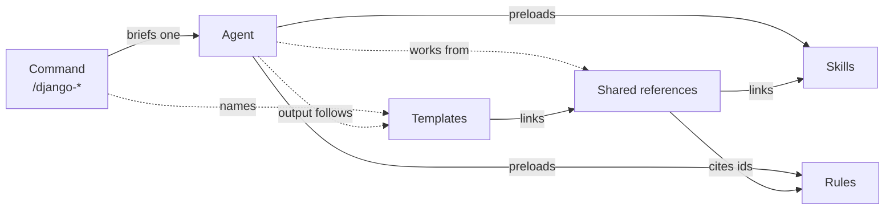

# Django Engineering Plugin reference

Detailed reference for the standalone Claude Code plugin `django-engineering`. Installation is in the
[project README](../README.md#installation). The optional Python harness is documented in
[harness.md](harness.md).

## The Django Engineering Pack

Phase 3 builds a Django Engineering Pack on top of the harness. Each component has one job, and
each kind of knowledge lives in exactly one place.

| Component | Where | Count | Holds | Reaches agents through |
|---|---|---|---|---|
| Skills | [`skills/`](../skills/README.md) | 12 | How to do Django work well (topic knowledge) | agent `skills` in `config/agent-registry.yaml` (preloaded) |
| Rules | [`rules/`](../rules/README.md) | 12 | What every result must satisfy (`<PREFIX>-M<n>` requirements) | the same `skills` lists, tagged `rule` |
| Agents | [`agents/`](../agents/README.md) | 9 | One role each: when and how to apply skills and rules, tools, output | the registry (harness) or Claude Code subagents (commands) |
| Commands | [`commands/`](../commands/README.md) | 9 | Developer entry points: arguments, approval gates, the brief for one agent | Claude Code slash commands |
| Templates | [`templates/`](../templates/README.md) | 12 | The structure of each report: sections, placeholders, checklist | ids in each agent's `## Templates and references` and each command's Expected output |
| Shared references | [`references/`](../references/README.md) | 7 | Checklists and lookup tables used by several agents, citing rule ids and linking skills | ids in each agent's `## Templates and references` |



- **Commands** choose an agent and gate changes. They hold no Django knowledge.
- **Agents** are roles. Their inline Output skeleton is the minimum report; the matching template
  is the full standard and contains every inline heading (`tests/test_django_templates.py`).
- **Skills** explain; **rules** require; **shared references** turn both into checks; **templates**
  shape the result. Tests reject lines copied between these layers.
- None of these components grants tools. Tool access comes only from each agent's `tools`
  frontmatter, narrowed by `security-config.yaml`.

## Claude Code plugin (Phase 4)

The Django Engineering Pack is also a standalone Claude Code plugin, `django-engineering`. It
needs neither the Python harness nor the Agent SDK. Verified with Claude Code CLI **2.1.319** on
Windows. The harness's pinned SDK (`claude-agent-sdk` 0.2.177, bundled CLI 2.1.317) is untouched.

### One source of truth

The pack root is the plugin root. Claude Code loads the canonical files where they are:

```text
django-agentic-engineering/                  ← plugin root (${CLAUDE_PLUGIN_ROOT})
├── .claude-plugin/plugin.json               manifest (hand-written)
├── agents/        9 agents                  canonical; listed file by file in plugin.json
├── commands/      9 commands                canonical; listed file by file in plugin.json
├── skills/        12 skills                 canonical; "skills": ["./skills/", "./rules/"]
├── rules/         12 rules                  canonical; loaded as skills, in place
├── templates/     12 output templates       canonical; read at ${CLAUDE_PLUGIN_ROOT}/templates/
├── references/    7 shared references       canonical; read at ${CLAUDE_PLUGIN_ROOT}/references/
├── hooks/
│   ├── hooks.json                           PreToolUse + PostToolUse → django_pack_guard.py
│   ├── django_pack_guard.py                 standalone guard (stdlib only)
│   └── security-policy.json                 GENERATED from config/ + agents/ + plugin_packaging/
└── plugin_packaging/                        build · check · stage, standalone-security.yaml
```

| Component | How Claude Code finds it | Verified with the CLI (`init` frame) |
|---|---|---|
| Agents | `plugin.json` `agents` lists the 10 files (nine specialists and, since Phase 6, `django-orchestrator`). An explicit list replaces the folder scan, so `agents/README.md` is not loaded as an agent. | 10 agents, `django-engineering:<id>` (live-verified with CLI 2.1.322) |
| Commands | `plugin.json` `commands` lists the 10 files (same reason), including `orchestrate`. | 10 commands, `/django-engineering:<id>` |
| Skills and rules | `"skills": ["./skills/", "./rules/"]`. Rules already use the skill format, so no adapter is needed. | 24 skills, `django-engineering:<id>` |
| Preloading | Each agent's frontmatter `skills:` line, generated from `config/agent-registry.yaml` | the analyzer reported its 3 skills and 4 rules |
| Hooks | `hooks/hooks.json` (default location; not declared again, which would load it twice) | guard decisions observed live |

The derived content is drift-checked by `python -m plugin_packaging check` and by
`tests/test_plugin_packaging.py` / `tests/test_orchestration.py`, and it traces back to its sources:

1. `hooks/security-policy.json` records its sources in `_generated`. Since Phase 6 it includes the
   orchestrator's entry: `read-only`, plus a `delegates` allowlist taken from `specialists` in
   `config/orchestration-policy.yaml`.
2. The `skills:` line in each agent's frontmatter is marked by a `# skills: generated by ...` comment.
   It holds the registered skills and rules as `django-engineering:<id>`. The harness ignores
   it and keeps reading the registry. The orchestrator's line comes from the orchestration policy.
3. `hooks/shell_syntax.py` is a byte-for-byte copy of `core/shell_syntax.py`.
4. The routing section of `agents/django-orchestrator.md`, between the `BEGIN/END GENERATED`
   markers, is rendered from `config/orchestration-policy.yaml`. See [orchestration.md](orchestration.md).

```bash
.venv/Scripts/python -m plugin_packaging check   # exit 1 on drift or a structural problem
.venv/Scripts/python -m plugin_packaging build   # regenerate both after editing a source
```

### Naming: `/django-security` vs the security skill

Claude Code offers every plugin skill as a slash command too. With CLI 2.1.319, a command and a
skill with the same name collapse into one entry. `/plugin:name` runs the **command**, and a
model's `Skill(plugin:name)` call also resolves to the command, so the skill becomes
unreachable. The skill was therefore renamed **`django-security-engineering`**. That covers the
folder, the `name`, `config/skill-registry.yaml`, the three agent-registry entries, the agents,
commands, rules, skills, references, templates, READMEs and tests. No alias was added.
`/django-security` stays the developer command. `plugin_packaging check` rejects any future
name shared by two components.

### Templates and references after installation

Agent and command bodies name paths as `${CLAUDE_PLUGIN_ROOT}/templates/<id>.template.md` and
`${CLAUDE_PLUGIN_ROOT}/references/<id>.md`. Claude Code substitutes the variable in agent,
command and skill bodies (verified), so the paths never depend on the working directory. Claude
Code asks before every read outside the project. To make the files usable without a prompt per
read, the guard answers `allow` for Read/Grep/Glob by a pack agent inside the plugin's own
`templates/`, `references/`, `skills/` and `rules/`, and nowhere else. If a file cannot be read,
the agents are told to report its id and the path tried and to fall back to their inline Output
skeleton, never to rebuild it from memory. That behaviour was observed live with a missing template.

### Standalone plugin security

The guard (`hooks/django_pack_guard.py`, see [hooks/README.md](../hooks/README.md)) reuses
`config/security-config.yaml` unchanged and adds only what standalone use needs, from
`plugin_packaging/standalone-security.yaml`:

| Agent | Mode | Enforced |
|---|---|---|
| `django-project-analyzer`, `django-code-review-agent` | read-only | no file writes; shell redirections to files denied; only commands classified `read` run (SEC-06): file changes, `sed -i`, git writes, writing or test-running `manage.py` commands, package changes and every unrecognised command or tool are denied |
| `django-documentation-agent` | documentation-only | writes only to `docs/**`, `doc/**`, `*.md`, `*.rst`, `*.adoc`, `README*`, `CHANGELOG*`, `mkdocs.y*ml` inside the project; no shell |
| `django-security-agent` | confirm-writes | every Write/Edit, and every shell command or tool not classified `read` (SEC-06), needs your explicit confirmation in Claude Code's prompt, on top of the command's `--fix` gate |
| model, API, testing, performance, architecture agents | workspace-write | writes inside the project directory only |
| all nine | — | only their declared `tools`; `WebFetch`/`WebSearch` denied; `.env*`, `*.pem`, `*.key`, `secrets/**` and credential stores denied for reads, writes and shell tokens; environment dumps and piped downloads denied; destructive, network, history-rewrite and privilege commands **ask**; secrets masked in tool output |

- **Fails safe.** A crash, a timeout or a missing interpreter blocks the call (`onFailure: block`).
  So do a missing or corrupt policy, malformed input, or an unknown agent in the plugin's
  namespace (exit 2). All of these were verified with CLI 2.1.319: a hook that fails *without*
  `onFailure: block` lets the call through.
- **No escalation.** The guard never grants a tool, a write or a shell command. Commands declare
  no tools. Agent `tools` frontmatter is unchanged and equals the policy (tested).
- **Not the harness.** There is no audit log, approver service, artifact directory or execution
  store, and no native `permissions.deny` injection. Approval is Claude Code's own permission
  prompt (`ask`). In `-p` (non-interactive) mode an `ask` is refused. The guard covers the pack's
  agents only: the user's main session and other plugins are left to Claude Code's permissions.
  It does not claim equivalence with the harness security implementation.

### Install and use

Requirements: a Claude Code version that supports `onFailure` on command hooks (verified with
2.1.319 and 2.1.322), and `python` (3.8+) on `PATH`, because the guard runs as
`python …/django_pack_guard.py`. On Windows, Claude Code finds Bash only if it finds Git Bash;
otherwise set `CLAUDE_CODE_GIT_BASH_PATH` to `...\Git\bin\bash.exe`, or the agents run without
their Bash tool.

**From GitHub (normal installation).** The repository root holds `.claude-plugin/marketplace.json`,
a marketplace named `django-agentic-engineering` that lists this plugin with `"source": "./"`
(the repository root is the plugin root). See the [README](../README.md#installation) for the
commands. A GitHub marketplace is a git clone, so only tracked files are installed: no `.venv`,
`var/` or local settings.

**For one session from a working copy** (development; nothing is installed):

```bash
claude --plugin-dir .
```

**As a clean bundle** (optional, for example to hand the plugin over without the Python harness
sources). `stage` exports only the plugin's runtime files, byte for byte, with a generated local
marketplace named `django-engineering-pack` and `STAGED-FROM.json` (source path and SHA-256 of
every file). Re-stage after any change; never edit the stage.

```bash
.venv/Scripts/python -m plugin_packaging stage ../django-engineering-plugin   # outside the pack
claude plugin marketplace add ../django-engineering-plugin
claude plugin install django-engineering@django-engineering-pack
```

**Optional harness (Phase 5.6).** The plugin installed from the repository marketplace also
carries the harness distribution, inert until a user runs `/django-engineering:setup-harness` in a
project. Five commands manage it (`setup-harness`, `harness-status`, `enable-harness`,
`disable-harness`, `doctor`); none runs at installation or on its own, and none is needed for the
standalone plugin. A staged bundle ships the bootstrap (`harness_bootstrap/`) but not the harness, so
those commands report that the distribution is missing. The guard denies pack agents every path in
`.django-engineering/` (`protected_paths` in `plugin_packaging/standalone-security.yaml`). See
[harness.md](harness.md#repository-local-harness-phase-56).

**Confirm what loaded:**

| Check | How |
|---|---|
| Plugin, agents, skills, commands | `/agents` lists the 9 `django-engineering:` agents. `/help` and typing `/django-engineering:` list the 9 commands and 24 skills. Headless: `claude -p ok --output-format stream-json --verbose`; the first `system`/`init` line lists `plugins`, `agents`, `skills` and `slash_commands`, and should show no `plugin_errors`. |
| Each command | `/django-engineering:django-analyze`, `…:django-design <feature>`, `…:django-model <change>`, `…:django-api <endpoints>`, `…:django-security [scope]`, `…:django-test <target>`, `…:django-optimize <path>`, `…:django-document <docs> --dry-run`, `…:django-review [paths]` |
| Templates and references | Ask an agent to read its template by the path pattern in its instructions. The path starts with the plugin's install folder, and no permission prompt appears. |
| Security | Ask `django-project-analyzer` to run `echo x > out.txt`, or any agent to read `.env`. Each is refused with `django-engineering guard: …`. A `django-security-agent` edit raises a confirmation prompt. |

`claude plugin details django-engineering@django-agentic-engineering` shows the skills and hooks but
reports **Agents (0)**: it does not count agents listed file by file. The session `init` frame does
load all nine.

### Verification performed

- `claude plugin validate` passes for the pack and for the staged bundle. Its only warnings are the
  two READMEs, which it scans as an agent and a command although the runtime excludes them, and a
  missing icon.
- `--plugin-dir`, a parent-marketplace install and a staged-marketplace install (isolated
  `CLAUDE_CONFIG_DIR`) each loaded 9 agents, 9 commands and 24 skills with no `plugin_errors`.
- All nine commands ran live (haiku) on a throw-away Django project. Each dispatched its own agent.
  `/django-model`, `/django-api` and `/django-test` stopped at their proposal, and the
  workspaces were left unchanged.
- Guard decisions observed live:
  - `.env` read denied.
  - Read outside the project denied.
  - Analyzer `> file` and `git commit` denied, while `git status` ran.
  - `manage.py migrate` asked.
  - `env` denied.
  - Security-agent edit asked, then refused without approval.
  - Documentation write to `docs/` allowed.
  - AWS key and `SECRET_KEY` masked in Read and Bash output.

## Plugin guard limitations

- **Not the harness.** It is not equivalent to the harness security implementation: there is no
  audit log, approver service, artifact directory or native `permissions.deny` injection. It
  guards the pack's nine agents only, identified by the hook input's `agent_type`.
- **Bash checks are static analysis**, with the same parser as the harness (Phase 5.1). A script
  an agent writes and then runs, or a plain `$var` operand, is not bounded by them; inline code
  (`python -c`) asks, and is denied for read-only agents. The guard is not a sandbox: enable
  Claude Code's own sandbox for an OS boundary. Claude Code's environment is the user's own; the
  guard denies environment dumps and credential-variable expansions but does not filter it.
- **Failed commands are not redacted.** A Bash command that exits non-zero comes back as a tool
  *error*. Claude Code runs `PostToolUseFailure`, not `PostToolUse`, for it, and an
  `updatedToolOutput` there does not replace the text (verified with CLI 2.1.319). Secrets
  printed by a failing command therefore reach the model unmasked; files on the deny list are
  still never read. A workaround (rewriting commands with `updatedInput` so they always exit 0)
  was tested and rejected: Claude Code then judges the rewritten command, so `Bash(...)` allow
  rules stop matching. The harness's PostToolUse redaction goes through the same CLI and likely
  shares this gap. That was not verified, and Phase 2 is unchanged.
- **The guard needs `python` on `PATH`.** It fails closed: if `python` is missing, every tool
  call in the session is blocked while the plugin is enabled. Many macOS and Linux systems ship
  only `python3`; provide a `python` (for example `python-is-python3`, a virtualenv, or a symlink).
  Plugin `userConfig` defaults are not substituted into hook commands (tested), so the
  interpreter cannot be configured there.
- **Writes need the session's permission too.** `ask` decisions are refused in non-interactive
  (`-p`) runs. Claude Code itself asks before writes to paths with 8.3 short names (`ABCDEF~1`).
- **Validator and inventory quirks.** `claude plugin validate` warns about `agents/README.md`
  and `commands/README.md`, which it scans although the runtime does not load them.
  `claude plugin details` reports Agents (0) for agents listed file by file.
- **The plugin guard does not enforce that the testing agent changes only tests**, or similar
  per-agent path scopes beyond those in the table; those remain the agents' instructions and the
  commands' approval gates.
